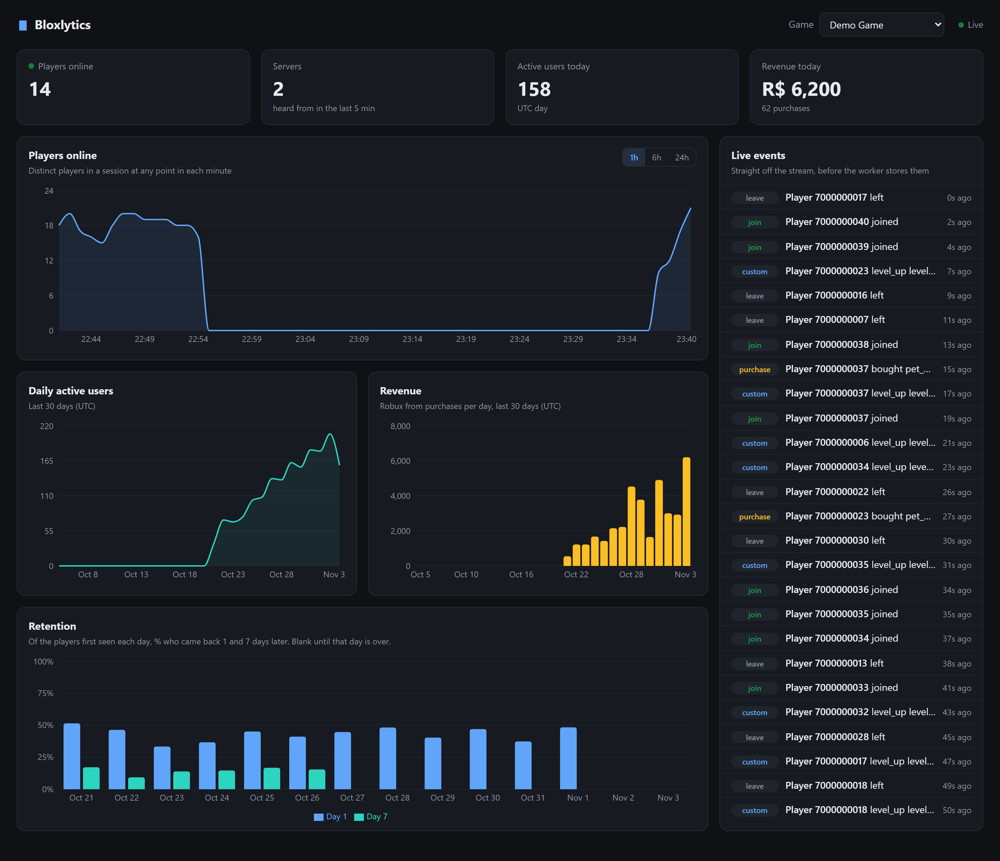
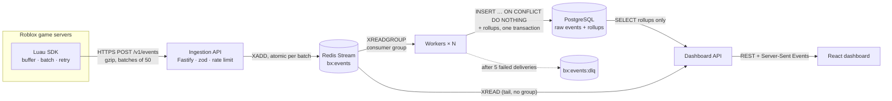

# Bloxlytics

[](https://github.com/haydenho08/bloxlytics/actions/workflows/ci.yml)

**Real-time analytics for Roblox games.** A Luau SDK batches gameplay events on
game servers. An ingestion API queues them in Redis Streams. Workers store each
event exactly once in Postgres and keep rollup tables up to date. A React
dashboard shows players online, daily active users, retention, revenue and a
live event feed.

**8,000 events/s sustained end to end** on one laptop (about 690M events/day),
with an ingest latency of **14ms p50**. [Benchmarks ↓](#benchmarks)



## Architecture



What each part is responsible for, and why:

- **The ingestion API never touches Postgres.** It authenticates the key (stored
  only as a SHA-256 hash), validates with zod, applies a per-game token-bucket
  rate limit and appends to the stream, then answers `202`. Database slowness can't
  slow down game servers. When the workers fall too far behind, it sheds load
  with a `503` instead of letting the queue grow forever.
- **Workers deliver at least once, and processing is idempotent.** An entry is
  acknowledged only after its transaction commits. `event_id` is unique, and
  rollups are updated only from rows the insert actually added, so a redelivered
  event can't be counted twice. Failures retry with backoff. After 5 deliveries
  an event goes to a dead-letter stream.
- **Rollups are computed when events are written, not when the dashboard reads.**
  DAU, revenue and sessions update in the same transaction as the raw insert.
  Players online and day-1/day-7 retention are recomputed over a recent window
  every 15 seconds. The dashboard reads tens of rows, never millions.
- **The live feed tails the same stream** with plain `XREAD`, outside the
  consumer group, so it can't steal work from the workers. It's pushed to
  browsers with Server-Sent Events.
- **The SDK runs only on the game server and is careful with resources.** It
  batches every 10s or 50 events, uses a bounded buffer that drops the oldest
  events when full, and retries with exponential backoff and jitter (never a 4xx
  except 429). It stays under Roblox's HTTP budget with its own token bucket,
  flushes on `BindToClose`, and keeps the API key in an experience secret.

Each stage has a walkthrough of its design decisions:
[1 · ingestion](docs/stage-1.md) ·
[2 · worker + storage](docs/stage-2.md) ·
[3 · Luau SDK](docs/stage-3.md) ·
[4 · dashboard](docs/stage-4.md) ·
[5 · load test, CI, deploy](docs/stage-5.md)

## Benchmarks

[`packages/loadgen`](packages/loadgen) simulates game servers that behave like the
SDK:
- 200 servers × 20 players
- batches of 50, gzip bodies
- one request in flight per server
- events generated on a clock, not as fast as responses come back

Each target rate runs for 30 seconds after a 5-second warm-up. Every service,
including the load generator, runs in Docker on one machine. **Sustained** means
the API accepted at least 97% of what was offered *and* the stream backlog
didn't grow during the step: the workers kept up.

| Workers | Max sustained | Ingest p50 | Ingest p95 | Event stored after (p50) |
| ------: | ------------: | ---------: | ---------: | -----------------------: |
| 1       | 4,000 ev/s    | 7.3 ms     | 14.9 ms    | 0.76 s                   |
| 2       | 7,000 ev/s    | 9.0 ms     | 27.8 ms    | 0.68 s                   |
| 4       | 8,000 ev/s    | 13.9 ms    | 120 ms     | 0.14 s                   |

Running the ingestion API alone, with no workers, one Node process accepted
**30,000 ev/s** (600 req/s, p50 128ms) before the stream reached its
1M-entry backpressure limit.

**Where the limit is.** Ingestion is far from saturated; storage is the limit.
Sampling `pg_stat_activity` at 10k ev/s with 4 workers showed:
- Postgres busy on CPU in most samples
- about 20% of samples waiting on `Lock:transactionid`

Every worker's transaction updates the same few rollup rows: this game's
`daily_active_users` and `revenue_daily` for today. Those row locks are held until
commit, so the workers queue behind each other. That's why 2 → 4 workers adds
little. The next steps would be to route each game to one worker (partition by
`game_id`), or to accumulate rollup increments in memory and flush them once a
second. [docs/stage-5.md](docs/stage-5.md) has the full numbers and method.

<sub>AMD Ryzen 7 8845HS (8 cores / 16 threads), Windows 11, Docker Desktop
(WSL2, 16 CPUs / 8 GB). Postgres 16, Redis 7 with AOF `everysec`, Node 24.</sub>

## Run it

### Everything in Docker

Requires Docker only.

```bash
docker compose --profile app up --build -d
docker compose run --rm migrate node --import tsx packages/db/scripts/create-game.ts my-obby "My Obby"
```

- Ingestion API: http://localhost:8080
- Dashboard: http://localhost:8082

The second command prints the game's API key once. Add demo history and run the load generator:

```bash
docker compose run --rm migrate node --import tsx packages/worker/scripts/seed-demo.ts demo-game
docker compose --profile bench run --rm loadgen --steps 1000,2000 --step-seconds 20
```

### For development (hot reload)

Requires Node 22+ and Docker Desktop.

```bash
npm install
cp .env.example .env
npm run infra:up            # Postgres 16 on :5433, Redis 7 on :6380
npm run migrate
npm run create-game -- my-obby "My Obby"
npm run seed-demo -- demo-game
```

Then one terminal each:

| Command                     | What                                        |
| --------------------------- | ------------------------------------------- |
| `npm run dev:api`           | Ingestion API, http://127.0.0.1:8080        |
| `npm run dev:worker`        | Worker (run more than one to scale out)     |
| `npm run dev:dashboard-api` | Dashboard API, http://127.0.0.1:8082        |
| `npm run dev:dashboard`     | Dashboard with Vite, http://localhost:5180  |

On Windows, if PowerShell refuses to run `npm.ps1`, use `npm.cmd` instead of `npm`.

### In a Roblox game

Put the SDK's ModuleScript in `ServerScriptService` and start it from a server script:

```lua
local Bloxlytics = require(game.ServerScriptService.Bloxlytics)
local analytics = Bloxlytics.start({
	gameId = "my-obby",
	endpoint = "https://your-api.example.com",
	-- The API key comes from the experience secret "bloxlytics_api_key".
})
analytics:track("level_complete", player, { level = 3 })
```

Joins, leaves and heartbeats are sent automatically. Use `trackReceipt` in
`ProcessReceipt` to record purchases without double-counting them. See the
[SDK README](packages/sdk-luau/README.md) for setup, including enabling HttpService.

## Layout

| Package                  | What it is                                                     |
| ------------------------ | -------------------------------------------------------------- |
| `packages/shared`        | Event schemas (zod), stream format, dashboard response types   |
| `packages/db`            | SQL migrations, migration runner, hashed API keys              |
| `packages/api`           | Ingestion API (Fastify)                                        |
| `packages/worker`        | Consumer-group worker: stores events, builds rollups; seed script |
| `packages/dashboard-api` | Read-only API over the rollups, live SSE stream, serves the app |
| `packages/dashboard`     | React + Vite + Recharts dashboard                               |
| `packages/sdk-luau`      | Luau SDK for Roblox game servers (Rojo project)                |
| `packages/loadgen`       | Load generator and benchmark report                            |

## Tests and CI

```bash
npm test            # Vitest: 81 tests, integration tests against real Postgres + Redis
npm run lint
npm run typecheck
```

The tests include:
- the same event delivered twice is counted once
- a crashed worker's entries are taken over by another
- poison events reach the dead-letter stream
- a gzip bomb gets a `413`
- the live stream doesn't disturb the consumer group
- graceful shutdown finishes in-flight work

The 13 Luau specs run inside a Roblox Studio Play server against a fake API.

[GitHub Actions](.github/workflows/ci.yml) runs lint, typecheck, the tests (with
Postgres and Redis as service containers) and the Docker build on every push and pull request.

## Deploying

There's one Docker image; each service only changes its start command.
[docs/deploy.md](docs/deploy.md) covers it, free options first:
- **Your laptop plus a Cloudflare quick tunnel**, so published Roblox servers can reach it.
- **Student cloud credits** for an always-on demo.
- **A free Oracle Cloud VM.**
- Railway, if you'd rather pay about $5/month for managed Postgres and Redis.
